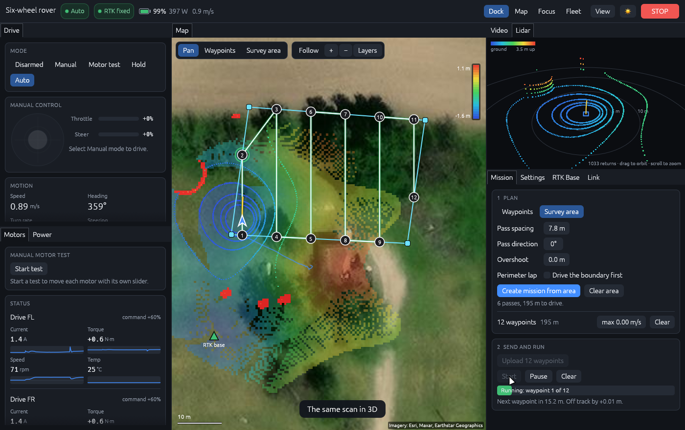
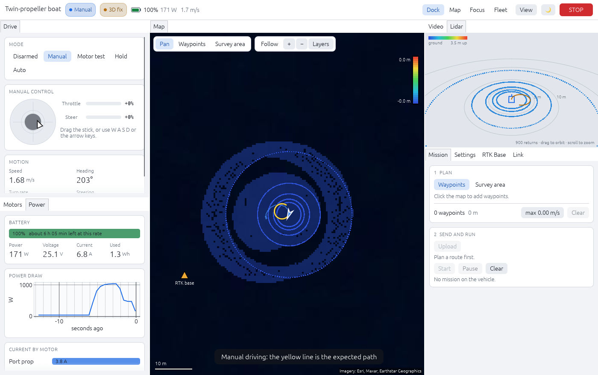
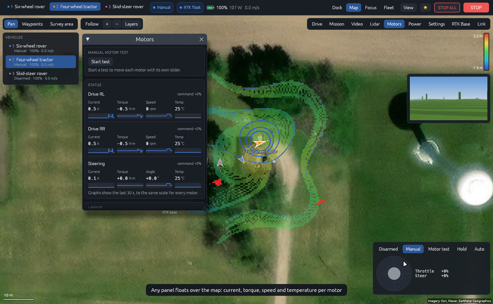
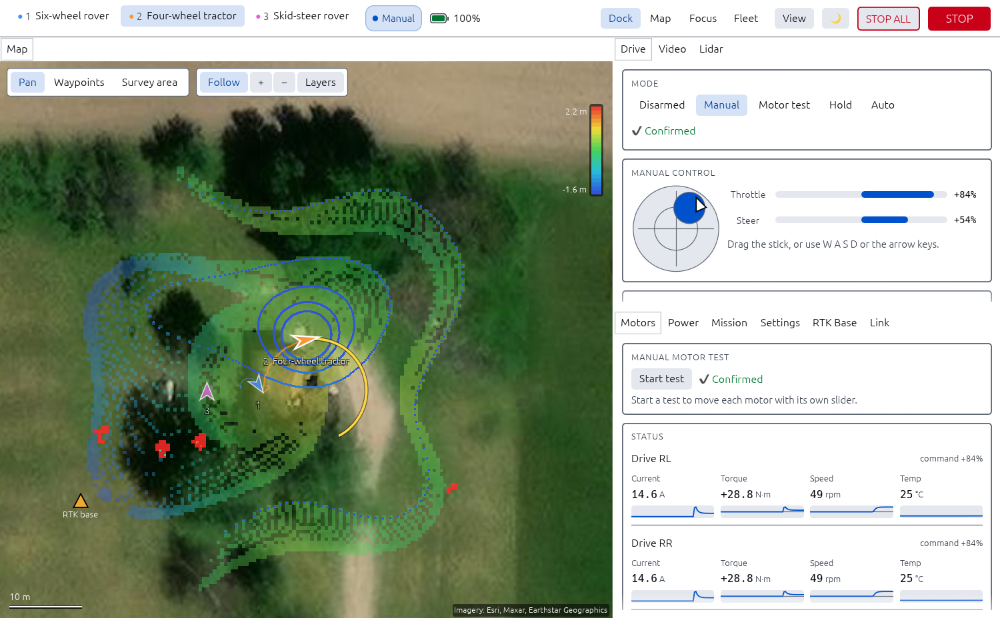
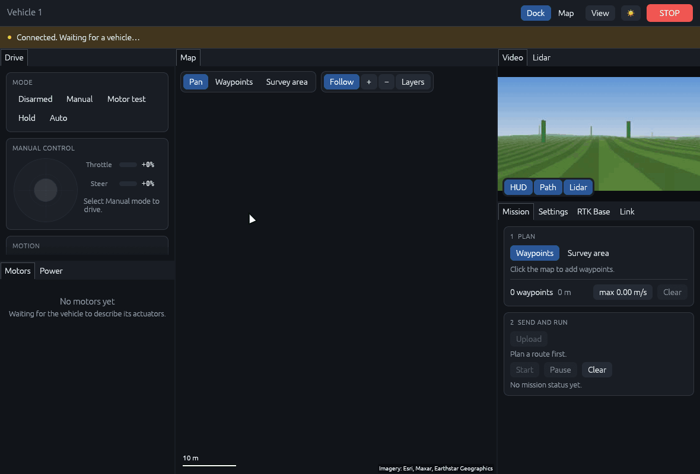
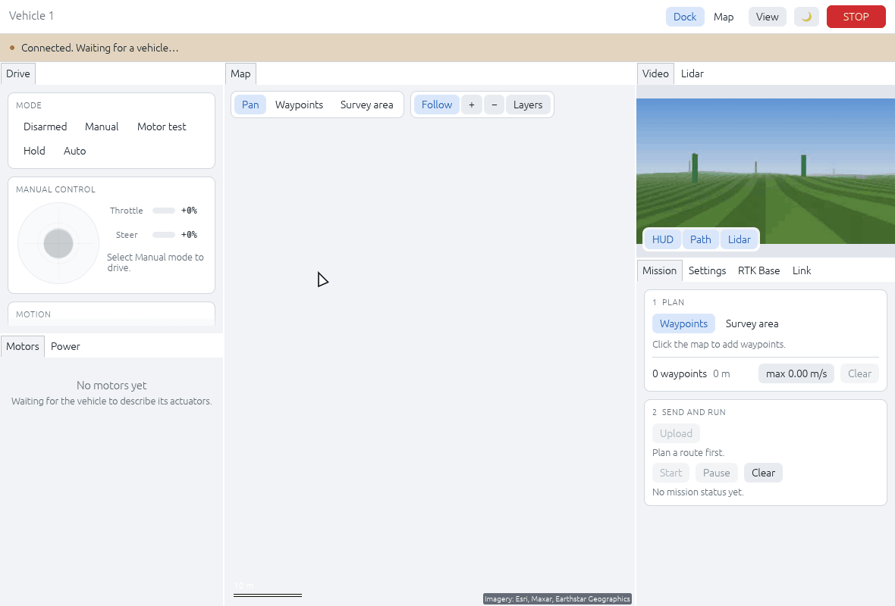
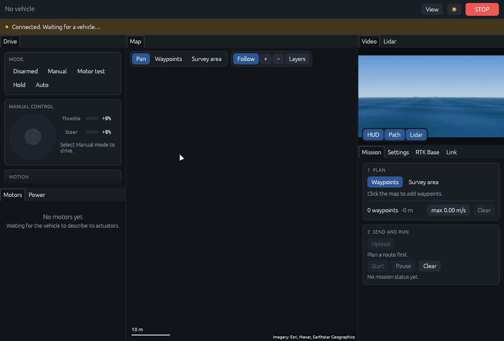
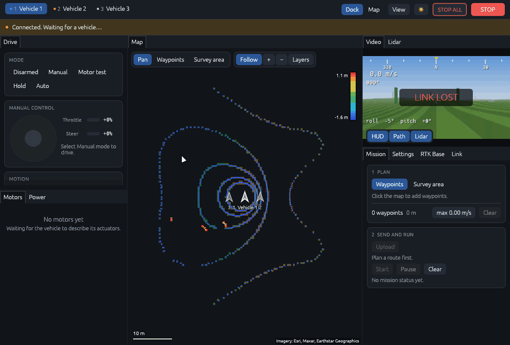
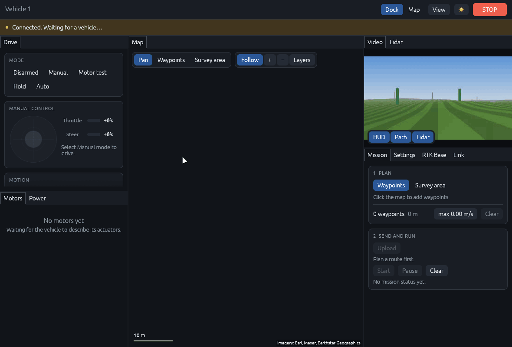
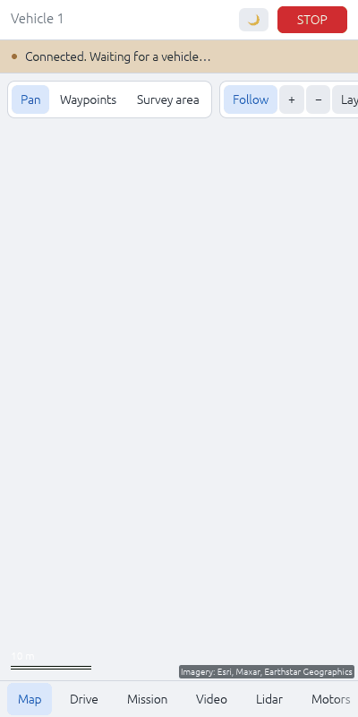

# Robotics GUI Framework

A ground-station GUI framework for rovers, tractors and boats, written in Rust end to end.
Proof of concept, taking its cues from Foxglove (dockable panels), QGroundControl (map,
missions, verified settings) and AgOpenGPS (field coverage).

- Map on ArcGIS World Imagery with waypoint missions and polygon surveys
- Movement control, power usage, and per-motor manual control with current, torque, speed
  and temperature for every motor
- Several vehicles on one link, with a switcher to choose which one the panels show and
  the controls drive
- A map layout: the map fills the window and everything else floats over it
- Settings and commands that show **Not sent** unless the vehicle confirms them
- RTK base station panel
- Expected path from velocity and wheel or rudder position
- Video with overlays, 3D lidar view, and lidar obstacles and terrain height on the map
- Four simulated vehicles: six-wheel rover, four-wheel tractor, four-wheel skid steer,
  twin-propeller boat
- [struct-frame](https://github.com/mylonics/struct-frame) messages on every link
- One UI codebase for desktop, browser and phone

| Dark | Light |
|---|---|
|  |  |

**Map layout with three vehicles**: the map is the background; the vehicle list, camera,
per-motor readout and drive controls are pinned over it, and any other panel opens as a
floating window.



## Designs

Besides the classic docked look above there are four complete designs, each with its own
layout, colours and both themes. They came out of a review of the screenshots and clips
on this page: [what the review found and what each design answers](docs/ux-review.md).

| | |
|---|---|
| **Horizon**: map edge to edge under glass cards, with a strip of the numbers that matter. `--design horizon` | **Workbench**: a rail of tools, one open at full height beside the map. `--design workbench` |
|  |  |
| **Fleet board**: a card per vehicle with its own stop button, and the selected one in detail. `--design fleet` | **Daylight**: high contrast and 20% larger for a tablet in the sun, in two columns. `--design daylight` |
|  |  |

Switch while running from **View → Design**.

## See it in use

These clips are recorded from the real application by its built-in demo scripts, which
drive the UI with pointer input (the cursor and captions are drawn by the demo).

**Plan and run a survey** (tractor, dark theme): outline an area, set the pass spacing,
upload, start.



**Manual driving and motor test** (six-wheel rover, light theme): joystick, expected
path, per-motor sliders, power.



**Verified settings** (boat): a change that is confirmed, one that shows *Not sent* with
the link cut, and the retry.



**Several vehicles in the map layout** (rover, tractor and skid steer): switch layout,
drive one, select another, open the Motors panel over the map, STOP ALL.



**Switching theme** (skid steer):



**Phone layout** (skid steer, light theme):



## Run it

```sh
cargo run -p station                      # desktop app with built-in backend and simulator
cargo run -p station -- --vehicle boat    # rover6 (default), tractor, skid, boat
cargo run -p station -- --vehicle rover6,tractor,skid   # several vehicles at once
cargo run -p station -- --layout map      # dock, map, focus or fleet (or use the switch in the bar)
cargo run -p station -- --design horizon  # classic, horizon, workbench, fleet, daylight
cargo run -p station -- --theme light     # dark is the default; the sun/moon button switches
cargo run -p station -- --phone           # try the phone layout in a small window
cargo run -p station -- --demo survey     # walkthroughs: survey, drive, linkloss, themes, phone
cargo run -p station -- --vehicle rover6,tractor,skid --demo fleet   # switching vehicles, map layout
```

To re-record a clip (release build recommended):

```sh
cargo run --release -p station -- --size 1180x800 --vehicle tractor --demo survey \
    --fps 6 --record docs/media/survey.gif
cargo run --release -p station -- --size 1180x800 --vehicle rover6,tractor,skid --demo fleet \
    --fps 6 --record docs/media/fleet.gif
```

The type of the selected simulated vehicle can also be changed from the **Link** panel
while running.

To run the parts separately, as they would be deployed, and use the UI from a browser or
phone on the same network (needs [Trunk](https://trunkrs.dev): `cargo install trunk`):

```sh
tools/run-dev.sh tractor                  # simulator + backend + web UI on :8080
tools/run-dev.sh rover6 tractor skid      # the same with three vehicles
```

or by hand:

```sh
cargo run -p rgf-sim -- --vehicle tractor      # vehicle, UDP 14560 -> 14550
cargo run -p rgf-backend                       # UDP 14550 <-> WebSocket 9002
cd apps/station && trunk serve                 # UI at http://<host>:8080
cargo run -p station -- --connect ws://HOST:9002   # or the desktop UI against that backend
```

For more vehicles, start one simulator each on its own port and start slot, and tell the
backend about them in the order they should be numbered:

```sh
cargo run -p rgf-sim -- --vehicle rover6  --bind 127.0.0.1:14560 --slot 0
cargo run -p rgf-sim -- --vehicle tractor --bind 127.0.0.1:14561 --slot 1
cargo run -p rgf-backend -- --vehicle 127.0.0.1:14560,127.0.0.1:14561
```

The web UI connects to port 9002 on the host that served it; override with
`?backend=ws://host:port`; add `?theme=light` to start in the light theme and
`?layout=map` to start in the map layout, `?design=horizon` (or another design) to start in it.

## Using it

| Panel | What it does |
|---|---|
| Map | Imagery, every vehicle (click one to select it), trail, expected path (yellow), mission, RTK base, lidar returns, obstacles (red) and terrain height (colour scale). Tools: **Waypoints** and **Survey area** add points on click; drag a point to move it, right-click to delete. |
| Mission | Waypoint list, survey settings (pass spacing, direction, overshoot, perimeter lap), upload, start, pause, progress and cross-track error. |
| Drive | Mode selection, joystick (or W A S D / arrow keys) in Manual. |
| Motors | One block per actuator the vehicle reports, above a sketch of where each is mounted: current, torque, speed (or angle for steering and rudders) and temperature, each with its last 30 s, plus commanded output and faults. In Motor test each has a slider. |
| Power | Battery state, time remaining, power history, current by motor. |
| Settings | Vehicle parameters. Each row shows whether the last change was confirmed. |
| RTK Base | Base status, survey-in or fixed-position setup, rover fix quality. |
| Video | Camera with heading tape, expected wheel tracks and lidar obstacle markers. |
| Lidar | Orbitable 3D point cloud coloured by height. |
| Link | Backend and vehicle link state; simulator vehicle picker and link-fault injection. |

The status bar shows mode, GNSS fix, battery and speed, and holds the layout switch (**Dock | Map | Focus | Fleet**), the
theme switch and the STOP button. A banner appears under it when the backend or vehicle
link is lost or the emergency stop is engaged.

### Several vehicles

With more than one vehicle the status bar lists them. Click one there, click it on the
map, or press its number key to select it. Every panel then shows that vehicle, and the
joystick, motor test, mission and settings act on it alone. The others keep reporting in
the background: their trails and positions stay on the map and a banner says if one stops
answering. Switching releases the joystick and motor sliders, and a vehicle that stops
receiving drive commands stops by itself. **STOP** stops the selected vehicle; **STOP ALL**
stops every one.

### Layouts

**Dock** is the tiled layout: panels can be dragged, split and tabbed.

**Map** puts the map behind everything. Pinned over it are the vehicle list, mission
progress, the camera picture, a table of current, torque, speed and temperature per motor,
and the mode buttons with the joystick in Manual. The row of names at the top right (or
**View**) opens any panel as a floating window that can be moved, resized, collapsed and
closed; a pinned card steps aside while its full panel is open.

**Focus** has a rail of tools down the left edge. One tool opens at a time between the
rail and the map, at full height; clicking it again closes it. The camera and drive
controls stay pinned over the map.

**Fleet** puts a card for every vehicle on the left (mode, speed, power, hottest motor,
battery, and a stop button each), the map in the middle, and one panel of detail for the
selected vehicle on the right.

A design (`--design`, **View → Design**) picks one of these layouts along with its colours,
shapes and size; see [Designs](#designs).

Panels can be dragged, split and tabbed in the Dock layout. Below 700 px wide the app switches to one panel
at a time with a tab bar, and puts a joystick over the map in Manual mode.

### Delivery verification

Everything that changes vehicle state carries a sequence number and stays *Sending* until
confirmed:

- Commands are confirmed by a `CommandAck` with the same sequence number.
- A setting is confirmed only by a `ParamValue` readback carrying that sequence number
  **and** the requested value. If the vehicle clamps the value, the row shows
  *Not applied* and the vehicle's actual value.
- The backend retries four times at 400 ms towards the vehicle, then reports a timeout;
  the UI shows **Not sent**. A rejected command shows **Rejected**.

Streamed inputs (joystick, motor-test sliders) are not acknowledged. They are resent ten
times a second and the vehicle zeroes them after 0.5 s of silence.

To see it: Link panel, tick *Cut the link completely*, *Apply fault*, then change a
setting or a mode.

## Layout

```
schema/              struct-frame message definitions (.sf)
gen/rust/            generated message and framing crate (checked in)
crates/rgf-core/     shared logic, no IO: codec, delivery tracking, client state,
                     geometry, path prediction, survey planning, terrain grid
crates/rgf-sim/      simulated vehicles, world, lidar and camera
crates/rgf-backend/  router with retries, RTK base, UDP and WebSocket server
crates/rgf-ui/       the framework: Panel trait, Workspace, Station, built-in panels
apps/station/        the application (desktop, web)
```

```
 UI (egui) <--WebSocket--> backend <--UDP--> vehicles or simulators
        id + struct-frame            struct-frame
```

The messages carry no vehicle id. The backend tells vehicles apart by the UDP address
their telemetry comes from and numbers them (those named with `--vehicle` first, in that
order). Each WebSocket message is one byte of vehicle number followed by struct-frame
bytes (`rgf_core::envelope`); 255 addresses the backend's base station, or every vehicle
for RTK corrections. Retries are tracked per vehicle.

All links use struct-frame's Bulk profile, because lidar scans and video chunks exceed
the 255-byte payload of the Standard profile.

## Extending

**A panel.** Implement `rgf_ui::Panel` and add it to a `Workspace`:

```rust
struct Depth;

impl rgf_ui::Panel for Depth {
    fn title(&self) -> &str { "Depth" }
    fn ui(&mut self, ui: &mut egui::Ui, station: &mut rgf_ui::Station) {
        if let Some(pose) = &station.client.pose {
            ui.label(format!("{:.1} m", pose.alt_m));
        }
    }
}

let mut panels = rgf_ui::panels::all(&ctx, None);
panels.push(Box::new(Depth));
let workspace = rgf_ui::Workspace::new(panels, rgf_ui::panels::DEFAULT_LAYOUT);
```

Take colours from `rgf_ui::theme::of(ui)` and build with the helpers in `rgf_ui::widgets`
(`card`, `chip`, `stats`, `meter`, `primary_button`) so a panel follows both themes.

`station` dereferences to the selected vehicle, so `station.client` holds that vehicle's
latest telemetry and sends commands to it; `station.vehicles()` lists all of them.
`widgets::tx_status(ui, station, label)` shows the delivery state of anything sent with
`client.send_tracked(label, ...)`.

**A message.** Edit a file in `schema/`, run `tools/gen.sh` (needs
`pip install struct-frame`), and add the type to the `messages!` list in
`crates/rgf-core/src/codec.rs`.

**A vehicle.** Add a `VehicleType` in `schema/common.sf`, then a `Spec`, a mixer and a
motion model in `crates/rgf-sim/src/vehicles.rs`. The UI builds its motor rows from the
actuator list the vehicle sends, so it needs no change unless the vehicle steers in a new
way, in which case add its curvature to `rgf-core/src/kinematics.rs`.

**A real vehicle.** Speak the messages in `schema/` over UDP to the backend's port 14550.
struct-frame generates the same messages for C, C++, Python and others.

**A real RTK base.** Implement `rgf_backend::base::BaseStation` for your receiver or
NTRIP source and pass it to `Router::new`.

## Tests

```sh
cargo test --workspace
```

`crates/rgf-backend/tests/end_to_end.rs` wires the client, the backend router and each
simulated vehicle together in memory: missions run to completion on all four vehicles,
settings are verified by readback, a cut link reports Not sent, and the RTK base brings
the rover to a fixed solution. A second rig runs several vehicles behind one router:
commands, emergency stop and link loss on one leave the others alone, and all share the
base station.

## Mobile

- **Any phone, including iOS:** the web build above, opened in the browser and added to
  the home screen.
- **Android native:** eframe supports Android through `android-activity`; the UI crate has
  no desktop-only dependencies. Packaging (NDK, `cargo-apk` or `xbuild`, an
  `android_main` entry point) is not set up in this proof of concept.

## Known limits

- The simulated base station sends placeholder RTCM and places itself near the vehicle.
- The simulated camera and lidar stay level; roll and pitch are reported but not applied
  to them.
- Vehicles do not collide with obstacles.
- A vehicle is identified by the UDP address it sends from. One that comes back on a
  different port shows up as a new vehicle, and the old entry stays as lost.
- One base station serves all vehicles and is placed by the first; a fleet spread over
  distant sites (the boat starts on a lake far from the others) shares it regardless.
- Video and lidar from every vehicle cross the link, though only the selected vehicle's
  picture is decoded.
- Sequence numbers are per UI; two UIs on one backend can, rarely, see each other's
  confirmations.
- The WebSocket and UDP links are unauthenticated and unencrypted.
