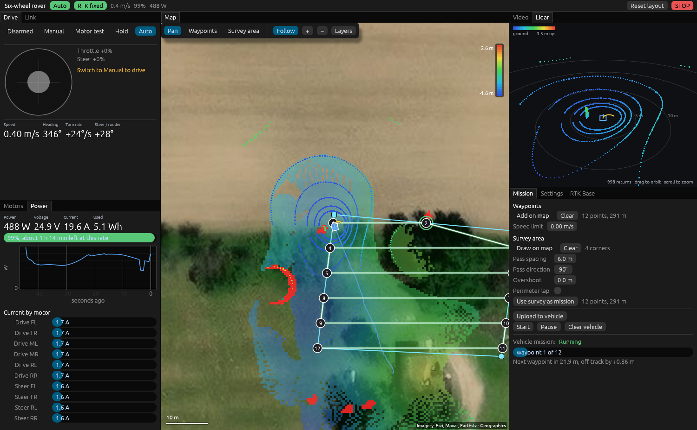

# Robotics GUI Framework

A ground-station GUI framework for rovers, tractors and boats, written in Rust end to end.
Proof of concept, taking its cues from Foxglove (dockable panels), QGroundControl (map,
missions, verified settings) and AgOpenGPS (field coverage).

- Map on ArcGIS World Imagery with waypoint missions and polygon surveys
- Movement control, per-motor manual control and status, power usage
- Settings and commands that show **Not sent** unless the vehicle confirms them
- RTK base station panel
- Expected path from velocity and wheel or rudder position
- Video with overlays, 3D lidar view, and lidar obstacles and terrain height on the map
- Four simulated vehicles: six-wheel rover, four-wheel tractor, four-wheel skid steer,
  twin-propeller boat
- [struct-frame](https://github.com/mylonics/struct-frame) messages on every link
- One UI codebase for desktop, browser and phone



## Run it

```sh
cargo run -p station                      # desktop app with built-in backend and simulator
cargo run -p station -- --vehicle boat    # rover6 (default), tractor, skid, boat
cargo run -p station -- --phone           # try the phone layout in a small window
cargo run -p station -- --demo survey     # scripted scenarios: survey, drive, linkloss
```

The vehicle can also be switched from the **Link** panel while running.

To run the parts separately, as they would be deployed, and use the UI from a browser or
phone on the same network (needs [Trunk](https://trunkrs.dev): `cargo install trunk`):

```sh
tools/run-dev.sh tractor                  # simulator + backend + web UI on :8080
```

or by hand:

```sh
cargo run -p rgf-sim -- --vehicle tractor      # vehicle, UDP 14560 -> 14550
cargo run -p rgf-backend                       # UDP 14550 <-> WebSocket 9002
cd apps/station && trunk serve                 # UI at http://<host>:8080
cargo run -p station -- --connect ws://HOST:9002   # or the desktop UI against that backend
```

The web UI connects to port 9002 on the host that served it; override with
`?backend=ws://host:port`.

## Using it

| Panel | What it does |
|---|---|
| Map | Imagery, vehicle, trail, expected path (yellow), mission, RTK base, lidar returns, obstacles (red) and terrain height (colour scale). Tools: **Waypoints** and **Survey area** add points on click; drag a point to move it, right-click to delete. |
| Mission | Waypoint list, survey settings (pass spacing, direction, overshoot, perimeter lap), upload, start, pause, progress and cross-track error. |
| Drive | Mode selection, joystick (or W A S D / arrow keys) in Manual. |
| Motors | One row per actuator the vehicle reports: rpm or angle, current, voltage, temperature, faults. In Motor test each has a slider. |
| Power | Battery state, time remaining, power history, current by motor. |
| Settings | Vehicle parameters. Each row shows whether the last change was confirmed. |
| RTK Base | Base status, survey-in or fixed-position setup, rover fix quality. |
| Video | Camera with heading tape, expected wheel tracks and lidar obstacle markers. |
| Lidar | Orbitable 3D point cloud coloured by height. |
| Link | Backend and vehicle link state; simulator vehicle picker and link-fault injection. |

Panels can be dragged, split and tabbed. Below 700 px wide the app switches to one panel
at a time with a tab bar, and puts a joystick over the map in Manual mode.

### Delivery verification

Everything that changes vehicle state carries a sequence number and stays *Sending* until
confirmed:

- Commands are confirmed by a `CommandAck` with the same sequence number.
- A setting is confirmed only by a `ParamValue` readback carrying that sequence number
  **and** the requested value. If the vehicle clamps the value, the row shows
  *Not applied* and the vehicle's actual value.
- The backend retries four times at 400 ms towards the vehicle, then reports a timeout;
  the UI shows **Not sent**. A rejected command shows **Rejected**.

Streamed inputs (joystick, motor-test sliders) are not acknowledged. They are resent ten
times a second and the vehicle zeroes them after 0.5 s of silence.

To see it: Link panel, tick *Cut the link completely*, *Apply fault*, then change a
setting or a mode.

## Layout

```
schema/              struct-frame message definitions (.sf)
gen/rust/            generated message and framing crate (checked in)
crates/rgf-core/     shared logic, no IO: codec, delivery tracking, client state,
                     geometry, path prediction, survey planning, terrain grid
crates/rgf-sim/      simulated vehicles, world, lidar and camera
crates/rgf-backend/  router with retries, RTK base, UDP and WebSocket server
crates/rgf-ui/       the framework: Panel trait, Workspace, Station, built-in panels
apps/station/        the application (desktop, web)
```

```
 UI (egui) <--WebSocket--> backend <--UDP--> vehicle or simulator
            struct-frame             struct-frame
```

All links use struct-frame's Bulk profile, because lidar scans and video chunks exceed
the 255-byte payload of the Standard profile.

## Extending

**A panel.** Implement `rgf_ui::Panel` and add it to a `Workspace`:

```rust
struct Depth;

impl rgf_ui::Panel for Depth {
    fn title(&self) -> &str { "Depth" }
    fn ui(&mut self, ui: &mut egui::Ui, station: &mut rgf_ui::Station) {
        if let Some(pose) = &station.client.pose {
            ui.label(format!("{:.1} m", pose.alt_m));
        }
    }
}

let mut panels = rgf_ui::panels::all(&ctx, None);
panels.push(Box::new(Depth));
let workspace = rgf_ui::Workspace::new(panels, rgf_ui::panels::DEFAULT_LAYOUT);
```

`station.client` holds the latest telemetry and sends commands;
`widgets::tx_status(ui, station, label)` shows the delivery state of anything sent with
`client.send_tracked(label, ...)`.

**A message.** Edit a file in `schema/`, run `tools/gen.sh` (needs
`pip install struct-frame`), and add the type to the `messages!` list in
`crates/rgf-core/src/codec.rs`.

**A vehicle.** Add a `VehicleType` in `schema/common.sf`, then a `Spec`, a mixer and a
motion model in `crates/rgf-sim/src/vehicles.rs`. The UI builds its motor rows from the
actuator list the vehicle sends, so it needs no change unless the vehicle steers in a new
way, in which case add its curvature to `rgf-core/src/kinematics.rs`.

**A real vehicle.** Speak the messages in `schema/` over UDP to the backend's port 14550.
struct-frame generates the same messages for C, C++, Python and others.

**A real RTK base.** Implement `rgf_backend::base::BaseStation` for your receiver or
NTRIP source and pass it to `Router::new`.

## Tests

```sh
cargo test --workspace
```

`crates/rgf-backend/tests/end_to_end.rs` wires the client, the backend router and each
simulated vehicle together in memory: missions run to completion on all four vehicles,
settings are verified by readback, a cut link reports Not sent, and the RTK base brings
the rover to a fixed solution.

## Mobile

- **Any phone, including iOS:** the web build above, opened in the browser and added to
  the home screen.
- **Android native:** eframe supports Android through `android-activity`; the UI crate has
  no desktop-only dependencies. Packaging (NDK, `cargo-apk` or `xbuild`, an
  `android_main` entry point) is not set up in this proof of concept.

## Known limits

- The simulated base station sends placeholder RTCM and places itself near the vehicle.
- The simulated camera and lidar stay level; roll and pitch are reported but not applied
  to them.
- Vehicles do not collide with obstacles.
- Sequence numbers are per UI; two UIs on one backend can, rarely, see each other's
  confirmations.
- The WebSocket and UDP links are unauthenticated and unencrypted.
