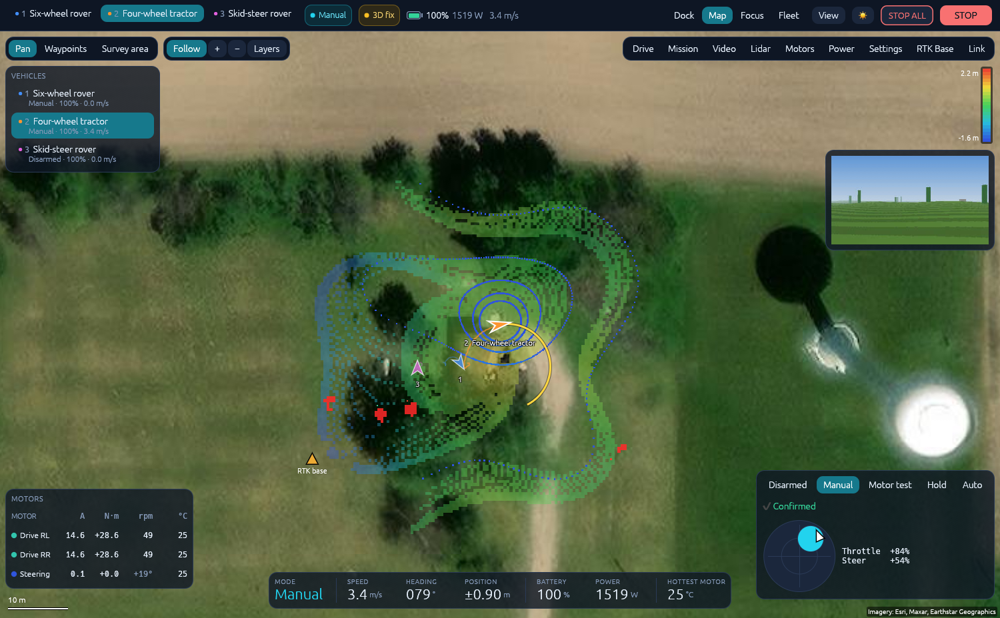
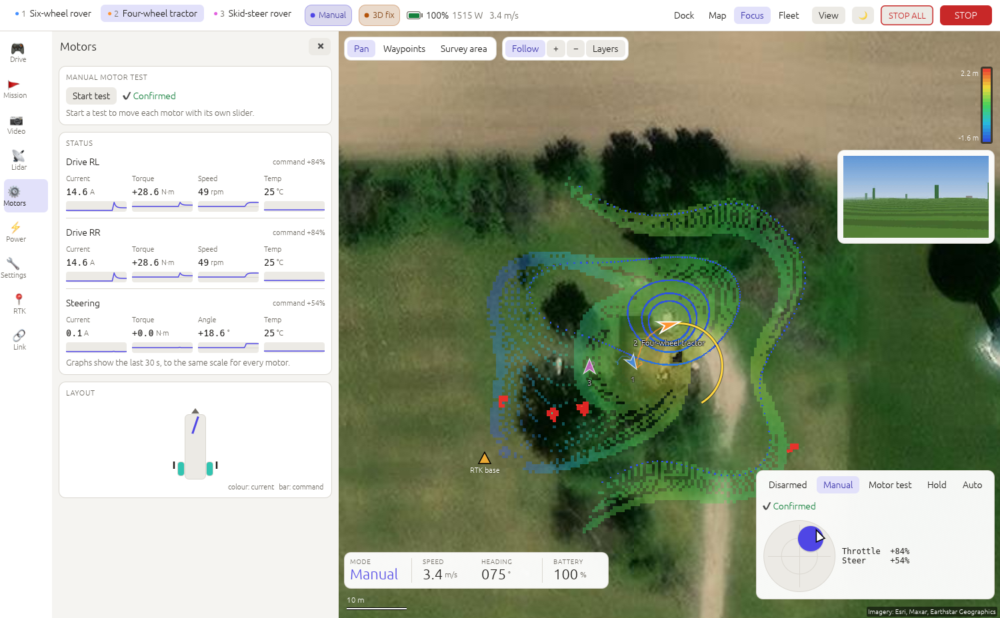
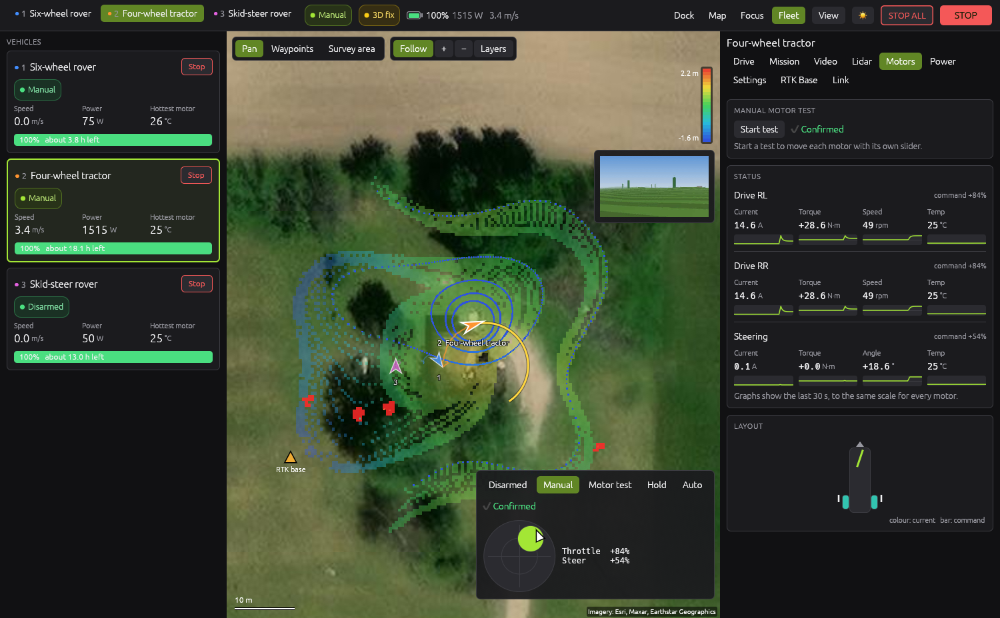
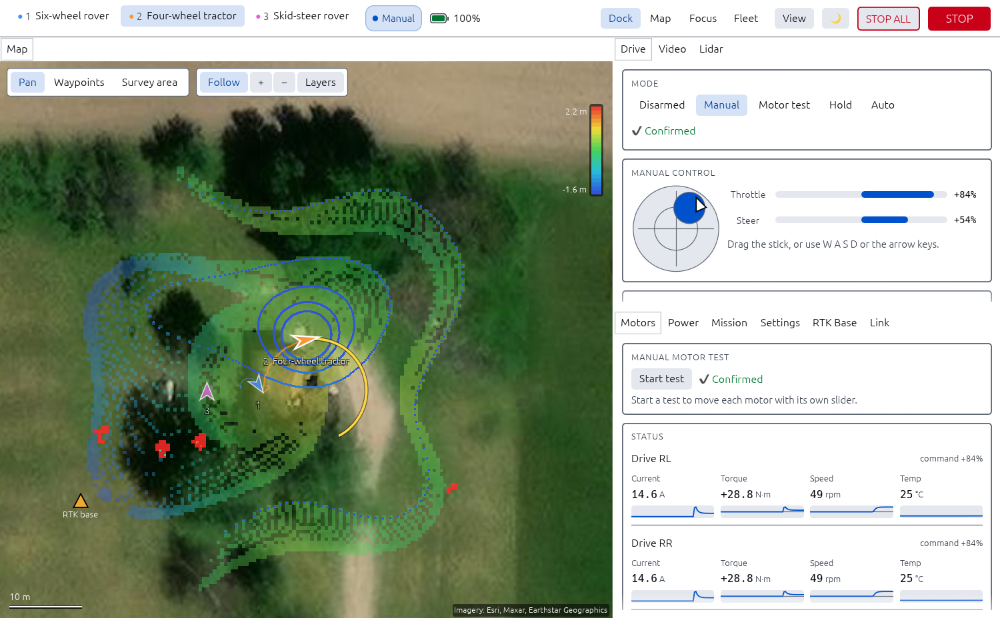

# UX review and the four designs

A review of the screenshots and recorded walkthroughs under `docs/`, and the four designs
built in response. Each design is in the application (`--design NAME`, or **View → Design**),
so the screenshots below are of the running program, not mock-ups.

## What the screenshots and clips showed

Reviewed: `desktop-dark.png`, `desktop-light.png`, `map-mode.png`, and frames from
`survey.gif`, `drive-light.gif`, `verified-settings.gif`, `themes.gif`, `phone.gif` and
`fleet.gif`.

**Layout and hierarchy**

1. **The most important numbers are the smallest.** Speed, heading, battery and mode are
   13 px text in the status bar, the same weight as the vehicle name. Nothing on screen
   reads at a glance from arm's length.
2. **The left column is too narrow for what it holds.** At 1180 px wide the mode buttons
   wrap and leave "Auto" alone on a second line, the Motion card is cut off after its
   first row in every clip, and the Motors panel shows only the test card and the layout
   sketch: the per-motor readings were below the fold in every screenshot.
3. **Three columns of equal visual weight.** Map, video, mission, drive and motors all
   compete; the map gets 46% of the width. Tab bars with a single tab ("Drive", "Map")
   spend 30 px each on a label that says nothing.
4. **Empty panels hold prime space.** The Mission panel sits open at the right with
   "Plan a route first" in most clips while the things in use are cramped.
5. **In the map layout a floating panel opens over the vehicle.** At 1180 px the Motors
   window covers the middle of the map, where the selected vehicle is.

**Legibility**

6. **Secondary text is small and faint.** Card headings and units are 10–11 px in the
   dim colour; on the light theme against white this is hard to read, and it would not
   survive daylight on a tablet.
7. **The terrain overlay fights the imagery.** At full extent it hides the ground it
   describes, and the lidar rings, the trail and the terrain all use blues.
8. **The light theme on water is a black map in a white frame.** There is no imagery
   over the lake, so the largest area of the light screenshot is black.

**Several vehicles**

9. **The switcher says who, not how.** The status-bar buttons carry a name and a dot;
   mode, battery and speed of the vehicles that are not selected are a hover away, or
   only in the map layout's list.
10. **Only the selected vehicle can be stopped individually.** Stopping another one means
    selecting it first, or stopping all of them.

**Phone**

11. **The status bar overflows.** The battery percentage is clipped by the theme button.
12. **Video is letterboxed in black**, using a third of the screen.

**What works and was kept**

- STOP is always in the same corner, red, and large.
- Every command shows Sending, Confirmed, Not sent or Rejected next to the control.
- The yellow expected path and the white mission lines read clearly over imagery.
- Per-vehicle colours on markers, trails and list entries.

One finding was fixed for every design: the Motors panel now puts the readings above the
layout sketch.

## The designs

| | Design | Layout | Answers |
|---|---|---|---|
| 1 | **Horizon** | Map edge to edge, glass cards, telemetry strip | 1, 3, 4, 7 |
| 2 | **Workbench** | Tool rail, one tool at full height, map | 2, 3, 4, 5 |
| 3 | **Fleet board** | A card per vehicle, map, selected vehicle's detail | 9, 10, 2 |
| 4 | **Daylight** | Two columns, 120% size, high contrast | 6, 2, 3 |

### 1. Horizon

```sh
cargo run -p station -- --vehicle rover6,tractor,skid --design horizon
```



The map is the application. Everything else is a translucent card pinned to an edge, so
the imagery shows through and nothing has a hard frame. A **telemetry strip** along the
bottom gives mode, speed, heading, position accuracy, battery, power and the hottest
motor in 22 px numerals: the answer to "how is it doing" without reading a panel. Deep
navy with one cyan accent keeps the interface out of the way of the map's colours.
Other panels open as floating windows from the row at the top right.

Best for: one operator driving or supervising a mission on a large screen.

### 2. Workbench

```sh
cargo run -p station -- --vehicle rover6,tractor,skid --design workbench
```



A rail of tools down the left edge, the way code editors and design tools work. One tool
is open at a time, at the full height of the window, so the Motors panel shows every
motor without scrolling and mode buttons never wrap. Clicking the open tool closes it and
hands the width to the map. The camera and the drive controls stay pinned over the map,
and a compact strip keeps mode, speed, heading and battery in view whichever tool is
open. Warm light neutrals with an indigo accent.

Best for: setup, tuning and diagnosis, where one panel has the operator's attention.

### 3. Fleet board

```sh
cargo run -p station -- --vehicle rover6,tractor,skid --design fleet
```



Every vehicle gets a card: mode, mission progress, speed, power, hottest motor, battery
with time remaining, and its own **Stop** button. The selected vehicle is outlined and
its detail fills the right-hand column, one panel at a time. Nothing about another
vehicle is hidden behind a click, and any one of them can be stopped without selecting
it. Graphite with a lime accent, tight corners, dense.

Best for: one person watching several vehicles.

### 4. Daylight

```sh
cargo run -p station -- --vehicle rover6,tractor,skid --design daylight
```



Built for a tablet outdoors. Everything is drawn 20% larger, text is near-black on
white, cards have a firm outline instead of a faint one, and status colours are darkened
until they hold up as text. Two columns instead of three: the map takes 61% of the
width, and Drive sits directly above Motors so the stick and the motor readings are on
screen together.

Best for: field use, touch, bright light.

## Using them

- `--design NAME` on the desktop, `?design=NAME` in the browser: `classic`, `horizon`,
  `workbench`, `fleet`, `daylight`.
- **View → Design** switches while running.
- A design sets colours, shapes, size, layout and starting theme. `--layout` and
  `--theme` override the last two, the **Dock | Map | Focus | Fleet** switch changes the
  layout at any time, and each design has both a light and a dark theme.
- A design is one entry in `rgf_ui::design::DESIGNS`.

## Not addressed

- The phone layout (findings 11 and 12) is unchanged; the designs apply to wide screens.
- The terrain overlay's opacity and the black map over water (7 and 8) are unchanged;
  Horizon only makes them compete with less interface.
- The floating-window placement in the Map layout (5) is unchanged; Workbench avoids it
  by not floating panels at all.
- The screenshots show a fleet a few seconds into driving; none of the designs has been
  tried by an operator.
